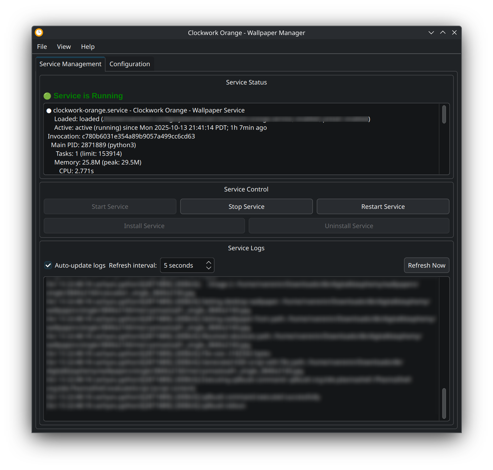

# Clockwork Orange

Wallpaper and lock-screen manager for KDE Plasma 6, Windows 10/11 and macOS 13+.
It rotates the desktop wallpaper (and on Plasma the lock-screen image) on a
timer from local folders and from download plugins, remembers every image it
has fetched so nothing is downloaded twice, and keeps a blacklist of images
you never want to see again.

Version 4 is a native Go program: one command-line binary that is also
the daemon, and one desktop window built with Fyne. No Python, no Qt, no
interpreter to install. Configuration files and databases from the 2.9.x
releases are read as they are.

[GUI.md](GUI.md) is a tour of the window with screenshots;
[WALKTHROUGH.md](WALKTHROUGH.md) covers Windows and macOS.

## What it does

- Sets a random wallpaper from one or more directories, one image per monitor,
  choosing sources fairly so a folder with ten images is picked as often as one
  with ten thousand.
- Sets the KDE lock-screen image, either the same rotation or a different image
  from the desktop ("dual wallpapers").
- Downloads wallpapers from Wallhaven (with an API key for the full catalogue)
  and from DuckDuckGo Images, on an hourly, daily or weekly interval, keeping
  at most a configured number of files per source.
- Records every download by URL and by content hash, so the same picture is
  not fetched again even after you delete the file.
- Blacklists images you mark in the window: the file is deleted and its hash
  kept, so a plugin that downloads it again deletes it at once.
- Runs as a systemd user service on Linux, and as a window with a tray icon
  everywhere.

## Installing

### Arch Linux

    yay -S clockwork-orange-git

The package installs `clockwork-orange`, `clockwork-orange-gui`, the launcher
entry, the icons and the systemd user unit.

### Debian and Ubuntu

Download the `.deb` from the releases page and install it with `apt install
./clockwork-orange_*.deb`. It recommends the KDE tool `kwriteconfig6`,
which Plasma 6 provides, for the lock screen.

### Installer (Linux and Windows)

The releases page has a self-contained installer for each platform:
`clockwork-orange-<version>-linux-amd64-installer` and
`…-windows-amd64-installer.exe`, built with
[fynstall](https://github.com/ushineko/fynstall).

- **From the desktop**, it opens a wizard. **From a terminal**, it asks on
  the command line, and `--yes` takes the defaults.
- **Where it installs:**
  - by default, for you alone, in `~/.local/share/io.ushineko.clockwork-orange`
    on Linux or `%LOCALAPPDATA%\Programs` on Windows;
  - "Everyone on this computer" installs to `/opt` or Program Files, and asks
    for an administrator once.
- **What it adds:** the launcher entry (Start Menu on Windows), the icons,
  and both programs on `PATH`.
- **No graphics libraries** (a server, a slim container)? Use the
  `-cli-installer` instead.
- **Removing it:** `<install directory>/uninstall`, or Settings > Apps on
  Windows. It removes what the installer added and leaves your
  configuration, images and databases.
- **The systemd service** is not part of the install. Turn it on from the
  window's Service section, or with `clockwork-orange service install`.

If you also have the Arch or Debian package, both copies are installed. The
one found first on `PATH` runs: `~/.local/bin` usually comes before
`/usr/bin`.

### From source (Linux)

    git clone https://github.com/ushineko/clockwork-orange
    cd clockwork-orange
    ./install.sh

This builds both programs and installs them under `~/.local` (binaries,
launcher entry, icons). It needs Go 1.25 or newer, and for the window a C
toolchain with the OpenGL and X11/Wayland headers; `./install.sh --no-gui`
installs the command line alone. `./uninstall.sh` removes exactly what
`install.sh` placed and leaves your configuration, images and databases where
they are.

### Windows and macOS

Besides the Windows installer above, the releases page has a zip for each.
The Windows zip holds
`clockwork-orange.exe` and `clockwork-orange-gui.exe`; the macOS zip holds
`Clockwork Orange.app`. On both, running the program with no arguments opens
the window.

The macOS app is signed ad-hoc, not with an Apple Developer ID, and is not
notarised. macOS quarantines anything a browser downloads, and refuses an
ad-hoc bundle outright rather than offering the usual "Open Anyway" — the
message is *"damaged and can't be opened"*, which is Gatekeeper declining it,
not a corrupt download. Right-click, Open no longer works either. Clear the
quarantine flag once, after moving the app to Applications:

    xattr -dr com.apple.quarantine "/Applications/Clockwork Orange.app"

It then launches normally, and the flag does not come back until you download
a new copy.

## Quick start

    clockwork-orange -f ~/Pictures/wallpaper.jpg        # set one file
    clockwork-orange -d ~/Pictures/Wallpapers           # a random image from a folder
    clockwork-orange -d ~/Pictures/Wallpapers -w 300    # and change it every five minutes
    clockwork-orange --lockscreen -d ~/Pictures         # the lock screen instead
    clockwork-orange --desktop --lockscreen -d ~/Pictures -w 600   # different images on each
    clockwork-orange --plugin wallhaven                 # download through one plugin, then set
    clockwork-orange                                    # open the window

With plugins enabled in the configuration file, `clockwork-orange --desktop`
alone collects every enabled source and sets from all of them; `--service`
does the same on a loop, with a default interval of 900 seconds, and picks up
edits to the configuration file within two seconds.

Every operation the window offers is also a subcommand:

    clockwork-orange service install|uninstall|start|stop|restart|status|logs
    clockwork-orange wallpaper status|pause|resume|skip
    clockwork-orange wallpaper pin FILE [--monitor N | --all | --lockscreen]
    clockwork-orange plugins list
    clockwork-orange plugin run wallhaven [--force] [--reset]
    clockwork-orange history stats|clear|import [DIR]
    clockwork-orange blacklist list|remove HASH...|add FILE...
    clockwork-orange config show|migrate
    clockwork-orange --self-test

Exit codes: 0 on success, 1 when an operation failed, 2 when the command line
was wrong. Log lines go to stderr with `[DEBUG]`, `[INFO]`, `[WARN]` and
`[ERROR]` prefixes; `--log-level info` quietens them.

## The window

`clockwork-orange-gui` (or "Clockwork Orange" in the application menu). The
sections, top to bottom:

- **Service** (Linux): the wallpaper on each monitor and the lock screen,
  with the time to the next change; Pause (holds what is on screen until
  Resume, across restarts) and Skip (a new wallpaper now); the systemd
  unit's state, start/stop/restart, install/uninstall, and the journal tail.
  On Windows and macOS this is **Activity**: the same wallpaper card and
  controls, and the log of what the window's own timer has done.
- **Local**, **Wallhaven**, **Duckduckgo Images**: one section per plugin.
  Each has an enable switch, a form generated from the plugin's settings,
  Download Now and Reset & Run (which open a progress window with the log and
  a preview of each saved image), and a review of the plugin's folder: the
  arrow keys move through the images newest first, Space marks one, Apply
  Blacklist deletes the marked images and records their hashes, and Pin shows
  the image on a monitor, every monitor or the lock screen and holds it there
  until Resume.
- **History**: how many downloads and unique images are recorded, Reset, and
  Scan & Import to record files already on disk.
- **Blacklist**: the blocked images with thumbnails, a filter, and Remove
  Selected to allow an image back.
- **Settings**: wallpaper mode (dual, desktop only, lock screen only), the
  interval, image extensions, debug logging, and on Linux the service's
  auto-start, restart delay and log refresh. Changes are saved a second after
  you make them. A read-only view of the YAML is at the bottom.
- **Appearance**: colour scheme (Breeze, Oxygen and Adwaita, plus Windows
  and macOS light and dark schemes for those desktops), font, text size,
  interface scale, and the console font and size used by the log panes.
- **About**: this document.

Closing the window hides it to the tray; the timer keeps changing wallpapers.
Quit from the tray menu. While the systemd service is running, the window's
own timer stays idle so the two do not both rotate.

## Configuration

`~/.config/clockwork-orange.yml` on every platform, written with sorted keys.
The window writes it; the command line reads it and `--write-config` creates
it from the flags you pass. Keys you add by hand and plugin blocks this
version does not know are kept.

    default_wait: 300
    dual_wallpapers: true
    plugins:
      local:
        enabled: true
        path: ~/Pictures/Wallpapers
      wallhaven:
        enabled: true
        api_key: ""
        query:
          - {term: landscape, enabled: true}
          - {term: forest, enabled: false}
        sorting: toplist
        top_range: 1M
        category_general: true
        purity_sfw: true
        atleast: 2560x1440
        ratios: 16x9
        download_dir: ~/Pictures/Wallpapers/Wallhaven
        interval: Daily
        limit: 10
        max_files: 100
      duckduckgo_images:
        enabled: true
        query: 4k nature wallpapers
        download_dir: ~/Pictures/Wallpapers/DuckDuckGo
        interval: Daily
        limit: 10
        max_files: 50

Top-level keys: `desktop`, `lockscreen`, `dual_wallpapers`, `default_wait`
(seconds), `default_directory` / `default_file` / `default_url`,
`image_extensions`, `debug`, `autostart`, `restart_delay`,
`logs_refresh_interval`, `auto_update_logs`, `console_font_family`,
`console_font_size`, `window_width`, `window_height`.

Each plugin's `interval` is `Hourly`, `Daily`, `Weekly` or `always`, tracked
in a `.last_run` file in its download directory. `max_files` keeps the newest
files and deletes the rest.

The download history is `~/.config/clockwork-orange/history.db` and the
blacklist `~/.config/clockwork-orange/blacklist.db`, both SQLite, both shared
with the 2.9.x releases.

## The service (Linux)

    clockwork-orange service install     # writes ~/.config/systemd/user/clockwork-orange.service, enables it
    clockwork-orange service start
    clockwork-orange service status
    clockwork-orange service logs -n 100

The unit runs `clockwork-orange --service` with the binary that installed it.
It reloads the configuration on every cycle and reacts to a saved edit within
about two seconds, so changing the interval or enabling a plugin in the window
takes effect without a restart.

## Stable Diffusion

The `stable_diffusion` plugin generates wallpapers on this machine with
[stable-diffusion.cpp](https://github.com/leejet/stable-diffusion.cpp), on the
CPU or a Vulkan GPU. Nothing is sent to a service.

**How it is embedded.** The program stays one file to install. The native
library (stable-diffusion.cpp, ggml and the Vulkan backend, about 96 MB) is
built in CI from the pinned tag `master-1088-32d516c` and compiled into the
binary with `go:embed`. On first use it is extracted to
`~/.cache/clockwork-orange/sd/<hash>/` and loaded at run time through
[malina](https://github.com/ardanlabs/malina) and `purego`, so the build needs
no C++ toolchain. A `VERSION` file in the library is checked against the pinned
tag before loading, because a mismatched library crashes the process.
`--self-test` reports `stable diffusion: <version>` when the library loads.
Setting `CLOCKWORK_SD_LIB` to a directory uses that library instead.

Builds that embed it are the `.deb`, the Linux installer and the Arch/AUR
package. The `.deb` and the installer carry the CI-built library and need glibc
2.38 and `GLIBCXX_3.4.32` (Ubuntu 24.04 or Debian 13 or newer; Debian 12 cannot
load it). The Arch/AUR package builds the library itself with cmake and the
Vulkan headers while it installs, which adds about a quarter of an hour, and
has no glibc floor of its own. Windows and macOS builds do not carry it yet;
there the plugin reports that the library is missing. To build one yourself, run
`make sd-lib-build` (needs cmake, a C++ toolchain, Vulkan headers and `glslc`),
or point `make sd-lib SD_LIB_SRC=<dir>` at a library you already have, then
`make build-sd` or `make build-gui-sd`.

**Models.** Weights are not bundled. `clockwork-orange models list` shows the
catalog and `models pull <name>` downloads one, as does the Pull button in the
window's Models card. A pull resumes if interrupted and is checked against a
pinned SHA-256 before it is used. The default folder is
`~/.local/share/clockwork-orange/models` (`CLOCKWORK_MODELS_DIR` overrides it).

| Name | File | Size | Licence |
|---|---|---|---|
| `sd-1.5` | `v1-5-pruned-emaonly.safetensors` | 4.3 GB | CreativeML Open RAIL-M |
| `sdxl-base-1.0` | `sd_xl_base_1.0.safetensors` | 6.9 GB | CreativeML Open RAIL++-M |

`model_id` takes a catalog name, a 2.9.x Hugging Face id for one of these
(`runwayml/stable-diffusion-v1-5`, `stabilityai/stable-diffusion-xl-base-1.0`),
or a path to a checkpoint you already have. Only `sd-1.5` has been generated
from end to end (an RTX 4090, 2.9 s per image once loaded); `sdxl-base-1.0` is
in the catalog but has not been run. Other architectures that
stable-diffusion.cpp reads may load from a path, but are not tested here.

Prompts follow the 2.9.x keys. A comma-separated string is split into several
prompts, so pass a one-item list to keep a prompt with commas whole. On a
machine with several GPUs, `device` picks one; the default is whichever Vulkan
lists first, which can be an integrated GPU.

## Upgrading from 2.9.x

Nothing to migrate: the configuration file and both databases are read as
they are. A `google_images` block is renamed to `duckduckgo_images` on first
load. The `stable_diffusion` block is read by the new plugin (see above); its
2.9.x keys keep their meaning, with `seed`, `threads`, `backend` and `device`
added. The Python launcher entry from `install-desktop-entry.sh` is removed by
`install.sh`, and `service install` replaces the Python unit.

## Building

    make build        # bin/clockwork-orange, CGO_ENABLED=0 (links glibc on Linux, see below)
    make build-gui    # bin/clockwork-orange-gui, needs CGO and OpenGL headers
    make test         # go test -race with the CLI/GUI parity guard
    make lint         # golangci-lint, pinned version
    make pkg-arch     # the Arch package, from this checkout
    make pkg-deb      # the Debian package

The command-line binary needs no C toolchain (`CGO_ENABLED=0`), but on Linux it
is no longer statically linked: the Stable Diffusion plugin loads a native
library through `purego`, which makes the binary link `libc`, `libdl` and
`libpthread` dynamically. It has no versioned glibc symbol requirement of its
own, and it does not run on musl (Alpine). Windows and macOS builds are
unaffected.

Layout: `cmd/` holds the two entry points; `internal/core` every user-facing
operation as a function, which both front ends call and nothing else may
bypass; `internal/platform` the KDE, Windows and macOS layers behind
interfaces; `internal/plugins` the three sources; `internal/config`,
`internal/store`, `internal/imaging`, `internal/engine` the rest.
`specs/010-go-rewrite-v4.md` is the design of record.

## Changelog

Kept from v4.7.0 onwards. Releases before it have no notes and none are
invented for them: a changelog written afterwards from commit messages
says what was touched, not what changed for anyone using it, and reads as
a record when it is a guess.

Every change worth telling a user about adds a line here under
`### Unreleased`, in the same commit as the change. Releasing renames that
heading to the version and its date, and those lines become the release
notes.

### Unreleased

- A `stable_diffusion` plugin generates wallpapers on this machine with
  stable-diffusion.cpp, on the CPU or a Vulkan GPU, with a Stable Diffusion
  section in the window and `models list` / `models pull` to fetch a model.
  The native library is embedded in the Debian package, the Linux installer
  and the Arch/AUR package (which builds it on install, about a quarter of an
  hour); Windows and macOS builds do not carry it yet (spec 031, #60).

### v4.7.2 (2026-11-11)

- The Wallpaper card in Activity no longer flips to "Not rotating" after a
  Skip while the window's timer is running (macOS, Windows). The window's own
  lock checks could collide and read as a second process. On those platforms
  the message no longer mentions a service (#55).

### v4.7.1 (2026-10-19)

- The Wallpaper card in Activity (macOS, Windows) now shows the new image
  and countdown as soon as the window changes the wallpaper. It could fall a
  change behind and read "Changing now…" until a Skip, which then showed the
  image the skip had just replaced. Reopening the window from the tray also
  brings the card up to date (#52).

## Licence

MIT. See LICENSE.
